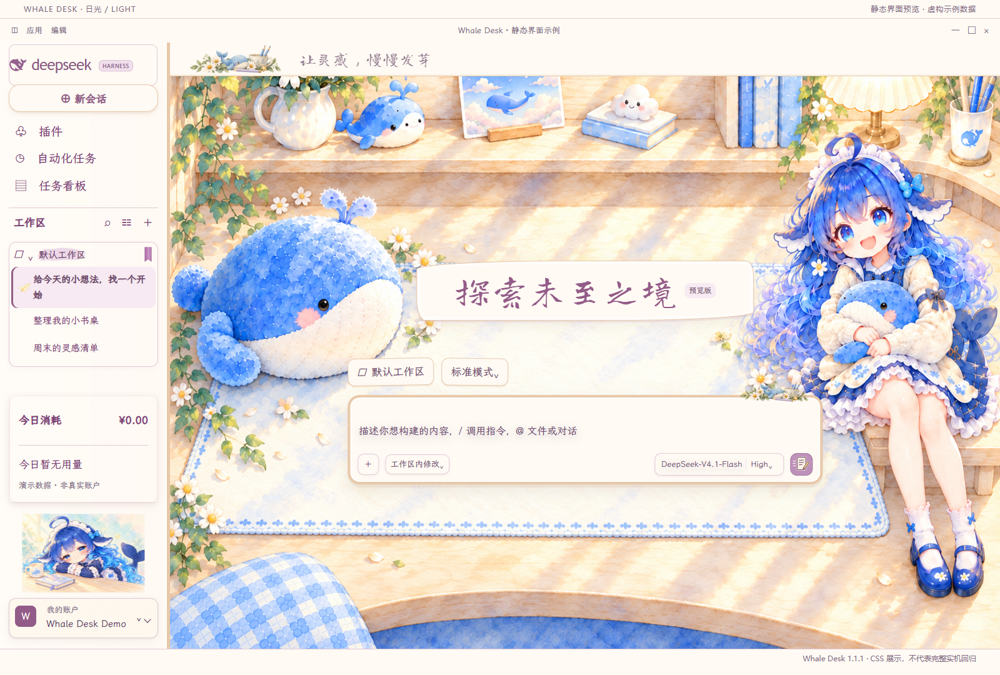
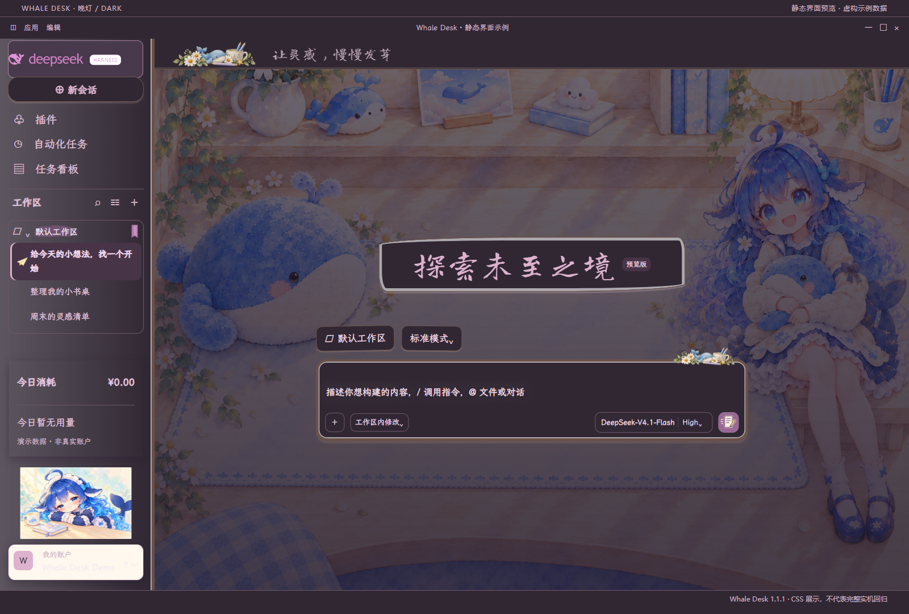
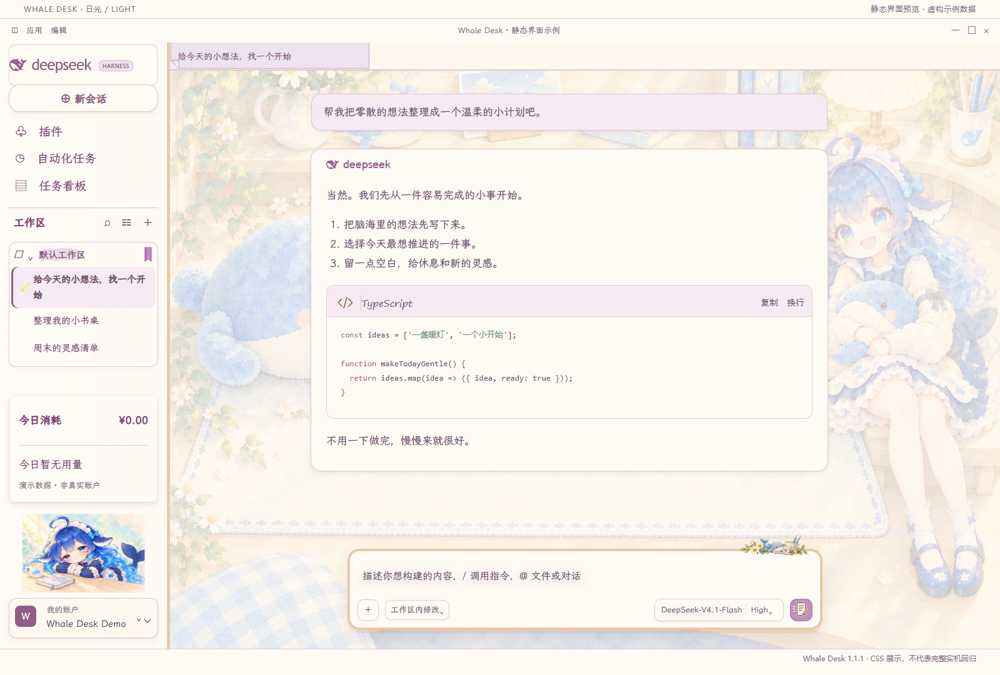
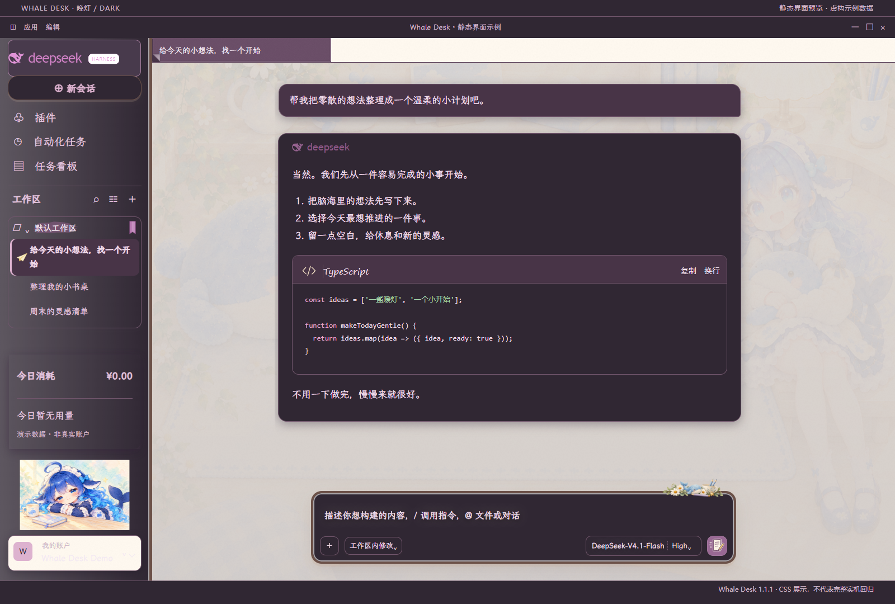
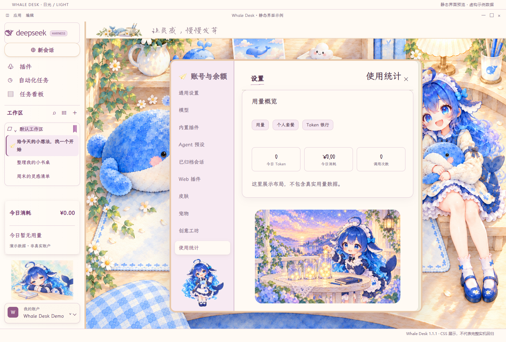
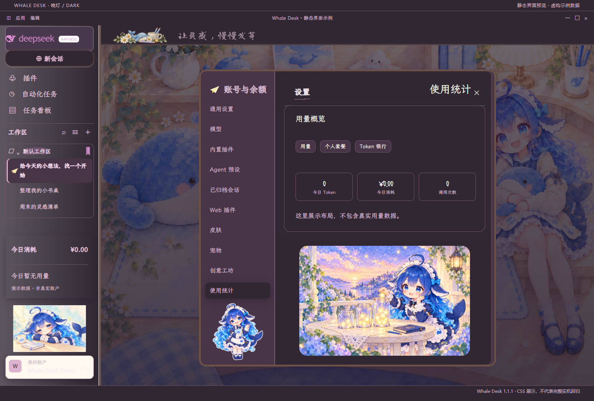

# Whale Desk

**A warm lamp, a little desk, and a whale companion for your next idea.**

[中文](README.md) · [Installation](INSTALL.md) · [Coverage](docs/PARITY.md) · [Validation](docs/TESTING.md)

## Documentation

The expanded [user manual](docs/USER-GUIDE.md), [installation walkthrough](INSTALL.md), [customization reference](docs/CUSTOMIZATION.md), [troubleshooting guide](docs/FAQ.md) and [documentation index](docs/README.md) are available in Chinese. They cover first use, updates, backups, all 14 artwork slots, parameter limits, pets versus static artwork, and reproducible bug reports.

For DIY, follow four steps: edit in the offline page, export JSON, apply it with the command below, then install the resulting skin in DSH. The page does not automatically save or change a running DSH instance.



*Static documentation fixture rendered with the shipped CSS and fictional data, not a native DSH screenshot.*

## Complete preview gallery



| Light conversations | Dark conversations |
| --- | --- |
|  |  |

| Light settings | Dark settings |
| --- | --- |
|  |  |

[Browse all components](docs/COMPONENTS.md): **40 categories, 80 component previews, 14 artworks, and 6 full interface previews — 100 images**. Category names match the upstream gallery. These static fixtures demonstrate CSS appearance; they do not establish runtime compatibility. [Generation and coverage notes](docs/PREVIEWS.md).

[Download the latest full repository](https://github.com/Xtsaixuexi/whale-desk-skin/archive/refs/heads/main.zip) and open `docs/gallery.html` for an offline, filterable gallery. The original v1.1.1 release ZIP predates this documentation expansion and remains unchanged.

A cream, warm-wood and watercolor theme for DeepSeek Harness. It preserves the familiar sidebar and conversation layout while adding mauve typography, soft ceramic surfaces, a narrower composer and watercolor flowers. LXGW WenKai is used for interface text; Long Cang for expressive headings; code keeps a monospace face.

## Install

Copy only `skins/whale-desk` to `$DSH_HOME/skins/` (default: `.dsh/skins/` under your user directory). Select **Whale Desk** in Settings → Skins. Restart DSH if its catalog has not refreshed. Back up an existing copy before updating. The skin needs no build, Python or Node runtime.

## Customize

Open `tools/editor.html` locally. Adjust light/dark colors, text size, composer width, the header motto and images for all 14 slots. Export JSON, then run with Node.js 22+:

```sh
node scripts/configure.mjs --config /path/to/whale-desk.config.json
```

The editor is offline. The command writes only to the repository skin by default and backs up its previous patch and configuration. Read [the customization guide](docs/CUSTOMIZATION.md) for reset and installation details.

Ready-to-import examples: [compact writing](docs/examples/compact-writing.json), [quiet reading](docs/examples/quiet-reading.json), and [full defaults](docs/examples/defaults.json). Importing an example replaces the configuration, with omitted fields returning to defaults; export your current design first.

`check-release.mjs` validates the public default package and intentionally rejects personal DIY CSS. It is not required after applying a personal configuration. Before publishing, save your JSON, reset the skin to defaults, and then run the release checks. The header motto is separate from the main artistic heading, and changing the pet settings illustration does not change the desktop pet.

## Scope and status

Derived from **DIY Journal 1.14.1** by [Alphazerolan](https://github.com/Alphazerolan/diy-journal-skin). The base implementation and assets match upstream commit `e68820404ee7183b0f9b15d7dd444b9f48e03071`; newer attribution documents have been incorporated. Fourteen inherited illustrations are recorded; the active home illustration is replaced, with the other 13 slots retained and reframed.

CSS covers conversations, menus, task panels, settings and both theme palettes. This is source coverage, not a claim that every interaction is tested. Native loading, the header/brand, composer proportions and usage settings were observed in 1.1.0 on Windows / DSH 0.2.1-rc.2 / Skin Center 0.4.8. Full 1.1.1 and dark-mode regression remain pending.

Desktop pets are separate DSH packages and are not bundled here or in the upstream skin repository. The upstream visual editor is also a separate project targeting `diy-journal`. Our offline editor does not include its two-photo collage, tape editing or in-app settings entry. Default installation registers no JavaScript hooks; native CSS state fallbacks remain available.

## Credits and license

Software and documentation: [MIT](LICENSE), preserving upstream attribution. Fonts retain their SIL OFL licenses. Bundled illustrations and character art are for personal, non-commercial use only. Character redistribution clearance remains independently unverified; this is unofficial fan work, not official DeepSeek art. See [NOTICE](skins/whale-desk/NOTICE), [artwork scope](LICENSE-ARTWORK) and [provenance](skins/whale-desk/ARTWORK.json).
