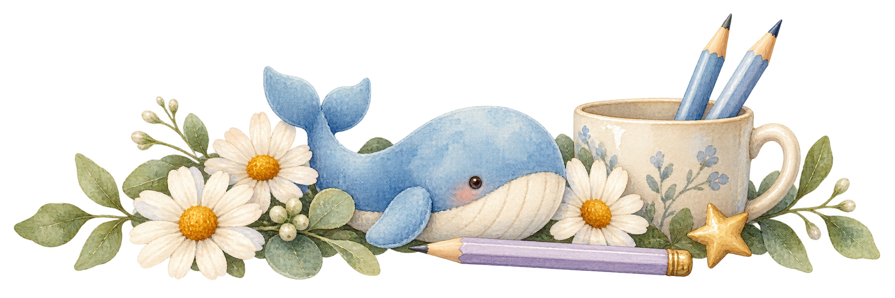

# 组件与配图

[返回首页](../README.md) · [逐项功能对照](PARITY.md) · [打开离线素材画廊](gallery.html)

本页展示实际随包素材与界面适配说明。图片是配图，不是组件实机截图；不复制原手账皮肤的截图作为本项目证据。完整操作验证状态见 [TESTING.md](TESTING.md)。

## 首页 · 奶油暖木与水彩

大鲸鱼玩偶在左，鲸鱼娘坐在右侧；中间留给欢迎标题与输入区。背景不含交互控件。

## 顶栏与输入托盘 · 水彩摆件

透明素材用于顶栏、输入区边缘和部分空状态。使用 CSS 装饰层，不承担按钮操作。

## 组件如何改变

| 模块 | 本版处理 | 原生功能 |
| --- | --- | --- |
| 品牌与欢迎标题 | 紫粉品牌字标，龙藏体“探索未至之境” | 原有入口和标题保留 |
| 侧栏 | 单一奶油整理区、浅木侧边、淡紫选中态 | 工作区、搜索、会话、用量、账号 |
| 输入区 | 760 px 最大宽、木沿卡片和小幅水彩花饰 | 输入、文件、模型、工作区与模式 |
| 对话 | 柔紫用户气泡、奶油助手卡、紫粉署名 | Markdown、展开及原生操作 |
| 代码 | 柔紫标题栏和圆角外框 | 复制、换行、等宽与语法配色 |
| 菜单 | 奶油底、细紫边和清晰选中态 | 原生选项、键盘焦点和禁用态 |
| 任务与自动化 | 奶油卡片、水彩空状态 | 状态、列表、详情和创建入口 |
| 设置 | 浅木外框、柔紫左栏、独立页面配图 | 各设置的原生逻辑 |
| 右侧工作台 | 木沿工具盘与水彩小摆件 | 项目文件、终端、浏览器入口 |

触发通知、问答、待办等次级组件仍保留部分上游手绘装饰；色彩已统一，不把这些描述成已全部重新绘制。

## 设置与侧栏插画

以下 13 个位置保留上游原始插画像素，调整 SVG 外框；原始首页图片也留在素材包中作为来源记录，但不再用于首页。

### 设置-账号与余额

鲸鱼存钱罐。

### 设置-通用设置

整理晨间小屋。

### 设置-模型

星图学习时间。

### 设置-内置插件

拼好一只小鲸鱼。

### 设置-Agent预设

准备下一次冒险。

### 设置-已归档会话

收藏温柔回忆。

### 设置-Web插件

海边电话。

### 设置-皮肤

挑选今日配色。

### 设置-宠物

草地上的小伙伴。

### 设置-创意工坊

手账文具小摊。

### 设置-使用统计

数一数今日星光。

### 设置界面左栏

拿手账招手的透明贴纸。

### 主界面左栏

休息一小会。

## 桌宠说明

“设置—宠物”的图片是装饰插画。真正桌宠的动作、菜单和拖动由独立宠物包决定，本仓库不包含其动画或私有配置。
