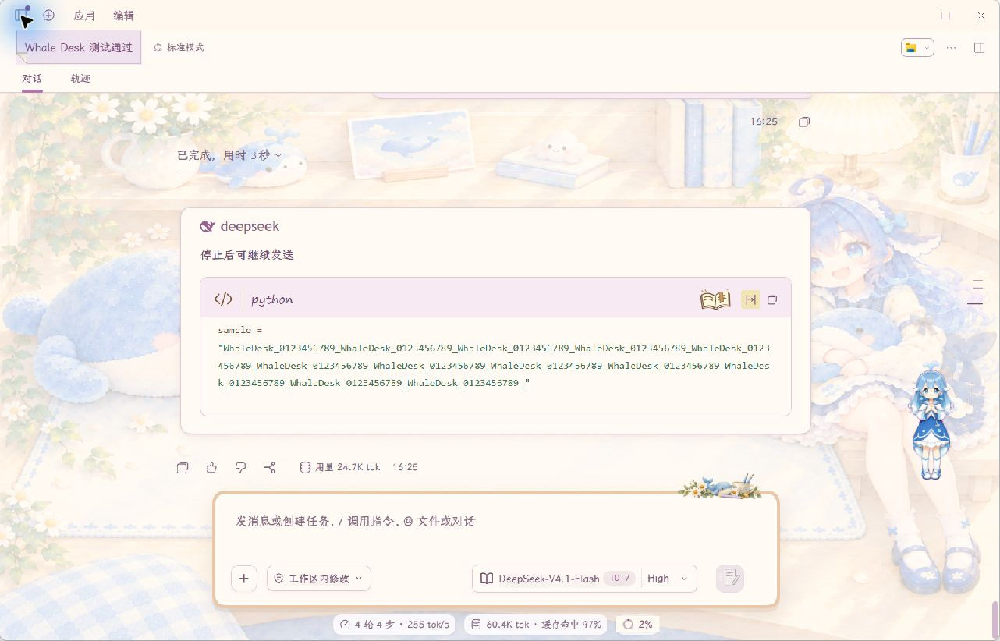
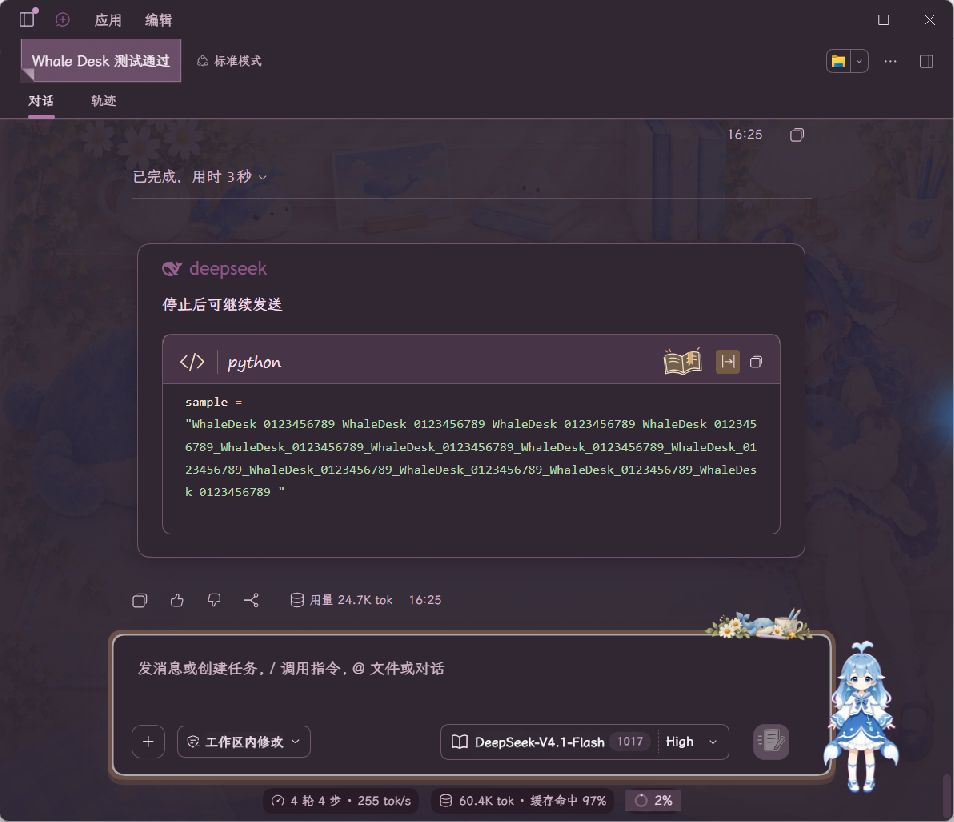
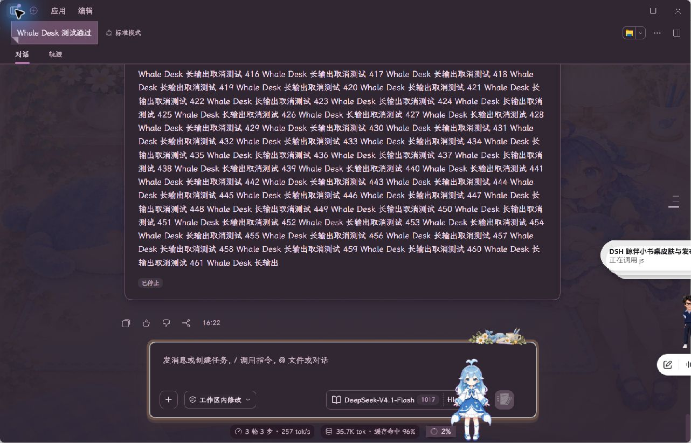
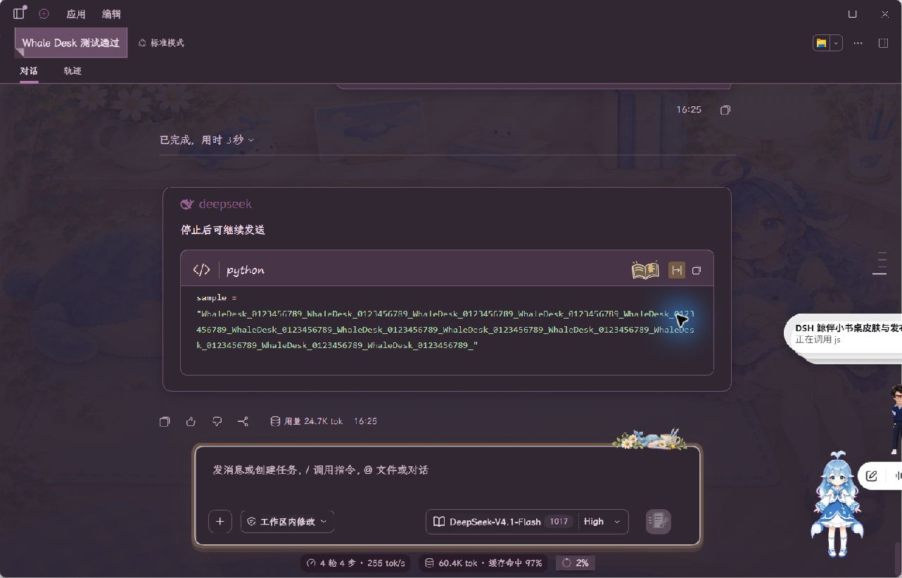

# 实机效果与操作记录

[项目首页](../README.md) · [完整测试记录](TESTING.md) · [静态组件图册](COMPONENTS.md) · [投稿状态](MARKET-SUBMISSION.md)

更新于 2026-11-08，Whale Desk 1.1.2。以下图片来自 Windows DSH 0.2.1-rc.2 / Skin Center 0.4.8 的真实窗口，使用正式 `whale-desk` 目录。账户侧栏在保存前收起，图片未修图。浮动桌宠由独立插件提供，不包含在皮肤安装包中。

## 浅色恢复后的真实对话

曾复现“点击浅色后回到深色”。用户重启 DSH 后恢复；随后执行浅色→深色→浅色，界面和保存配置同步更新，关闭设置后观察 88 秒仍保持浅色。这次恢复没有修改运行代码，尚未确定根因，也不能保证问题永不复发。遇到相同现象请按 [FAQ](FAQ.md#点击浅色后又自动回到深色) 排查。

## 深色与模型菜单

| 深色对话 | 模型菜单 |
| --- | --- |
|  |  |

修复了浅色纹理覆盖深色对话背景和顶栏的问题，并在正常退出、重新启动后确认生效。模型菜单打开、Escape 关闭和推理等级 High→Low→High 已操作验证；这不代表逐一调用过全部模型。

## 954 像素窄窗口

窗口尺寸为 954 × 822。侧栏自动收起、手动展开、代码与输入卡重排、模型菜单开关均已操作。展开侧栏时模型按钮文字会截短，完整名称可在菜单读取。更窄尺寸、全部缩放比例和窄窗口实际发送未验收。

## 停止输出与代码显示

| 明确停止生成 | 停止后继续发送与代码换行 |
| --- | --- |
|  |  |

180 行代码与表格生成完成；另一次长回复明确停止后，新消息正常完成。超长单行代码的换行开关与 [横向滚动](../evidence/native/code-scroll-dark.jpg) 已操作验证。新消息恢复成功不等于“重试上一轮”或网络重连通过。

## 使用时留意

- 桌宠的透明边缘也可能接收点击。窗口缩放、侧栏变化或重启后，检查它是否靠近发送、模型或弹窗按钮；拖到空白处即可重新核验。
- 覆盖正在使用的 CSS 后，现有窗口可能保留旧样式；先结束任务，再正常重开 DSH。重新应用皮肤不保证立即刷新。
- 图片展示某个时刻的界面；完整通过项、未测范围和上游测试失败以 [TESTING.md](TESTING.md) 为准。
- [100 张组件图册](COMPONENTS.md) 采用虚构数据渲染，是静态外观示例，与本页原生操作截图分开记录。

更多自动化、任务看板与对话框截图见 [原生证据说明](../evidence/native/README.md)。
