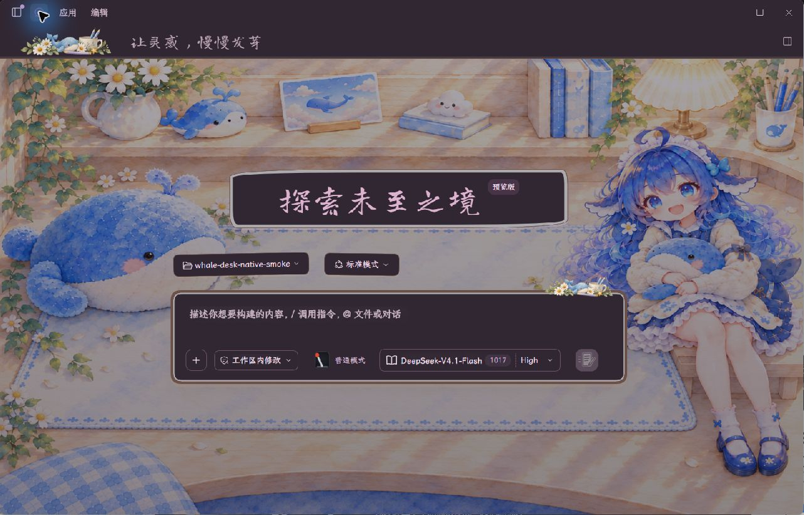
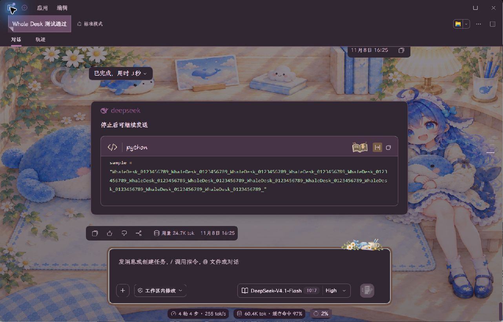

# 实机效果与操作记录

[项目首页](../README.md) · [完整测试记录](TESTING.md) · [静态组件图册](COMPONENTS.md) · [投稿状态](MARKET-SUBMISSION.md)

2026-11-17，Whale Desk 1.1.3，Windows DSH 0.2.1-rc.2 / Skin Center 0.4.8。
以下图片来自正式 `whale-desk` 目录正常重启后的真实窗口，1282 × 822；桌宠已关闭，账户及历史侧栏已收起，没有其他浮窗。JPEG 为原始捕获，未修图、未裁切。画面中的鲸鱼娘是皮肤背景插画。

## 欢迎页

| 浅色 | 深色 |
| --- | --- |
|  |  |

## 聊天页

| 浅色 | 深色 |
| --- | --- |
|  |  |

深色背景减轻遮罩，聊天背景保留更多插画；正文、代码、完成提示、时间和消息操作使用独立底色。对话使用先前创建的界面测试会话，本轮没有发起新的模型请求。

截图与运行文件 SHA-256 见 [捕获清单](../evidence/native/review-20261117/manifest.json)。市场正文内的图片与投稿分支证据文件使用同一份字节。

## 测试边界

这些截图证明本机此版本的外观，不能证明所有版本、平台、动态桌宠或跨设备同步。历史原生测试保留在 [旧记录](../evidence/native/README.md)，旧截图不作为 1.1.3 的当前视觉证据。浅色自动回退曾在重启后恢复，尚未定位根因。
