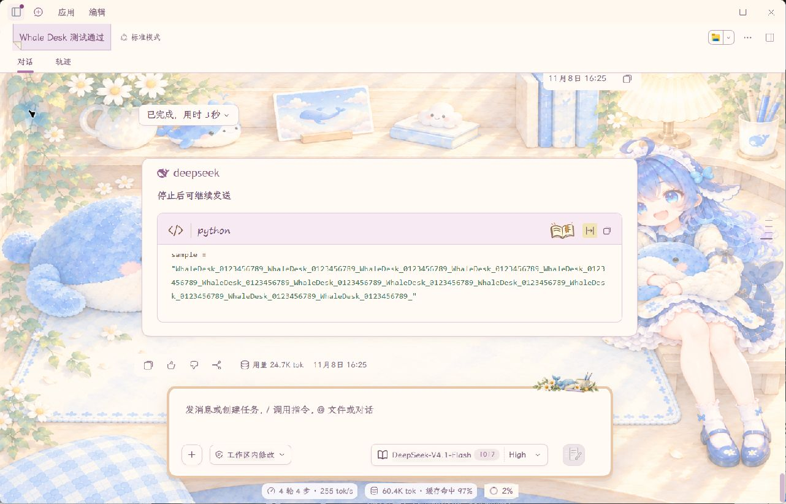
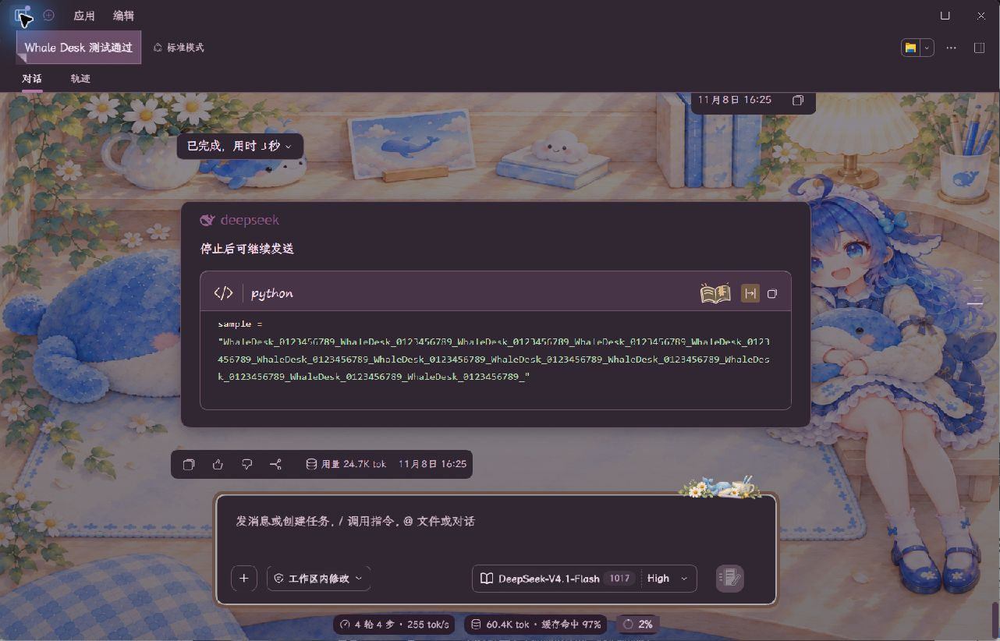
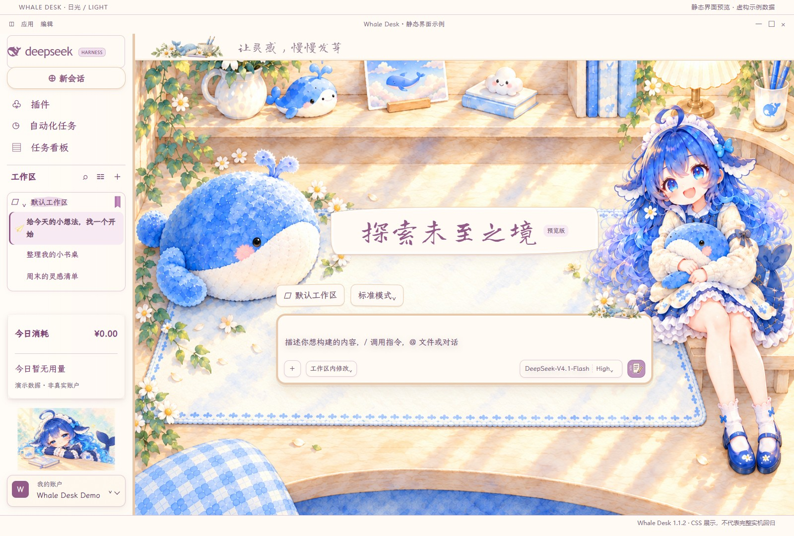
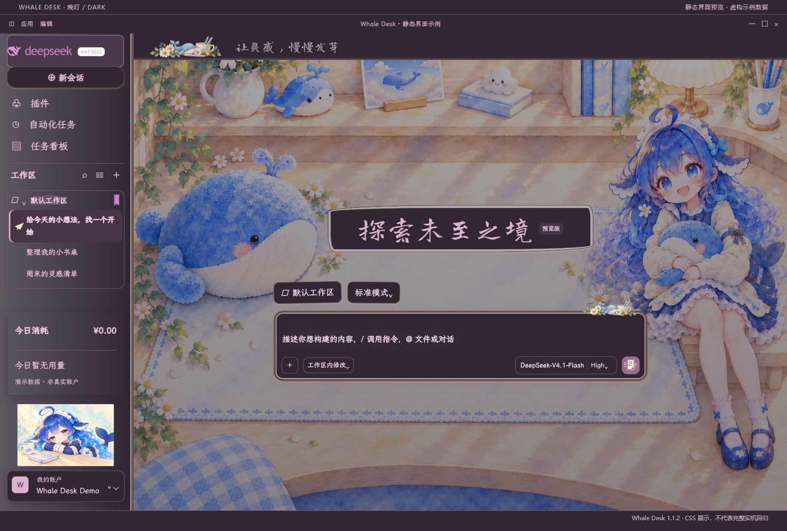

# 鲸伴 · 水彩小书桌

[English](README.md)

**开发与改造作者：Xtsaixuexi。**

Whale Desk 1.1.3 是 DSH 的非官方水彩小书桌皮肤，基于 Alphazerolan 的
[DIY Journal 1.14.1](https://github.com/Alphazerolan/diy-journal-skin) 改造。
奶油暖木、紫粉柔字和鲸鱼娘配图保留原生的侧栏、对话区与工作台布局。

## 安装与更新

将整个目录复制到 `$DSH_HOME/skins/whale-desk`；默认位置是
`~/.dsh/skins/whale-desk`。在 DSH 的“设置 → 皮肤”选择 Whale Desk。
使用皮肤不需要构建、Node.js 或 Python。更新前先备份个人修改。
覆盖正在使用的皮肤文件后，先恢复“官方默认”，再应用 Whale Desk，
再核验新样式。此操作不保证清除旧窗口的缓存，详见文末更新提示。

本包仅包含 CSS、字体和素材，不注册可执行钩子。桌宠由独立的 DSH
宠物插件管理，本包不含桌宠动画，也不是 DeepSeek 手机 App 主题。

## 实机效果与投稿状态

截至 2026-11-17，[投稿 #106](https://github.com/zhu1090093659/dsh-skins/pull/106) 已关闭，未合并上架；最新干净截图已补充，仍需补齐原角色许可依据。贡献者已确认 Alphazerolan 授权使用皮肤和配图，具体记录及未核实范围见 NOTICE。

| 浅色实机 | 深色实机 |
| --- | --- |
|  |  |

1.1.3 原生窗口，关闭桌宠并收起账户/历史会话侧栏后直接保存，未修图。完整范围见[测试记录](TESTING.md)。

## 预览与验证

图片使用随包 CSS 和虚构数据渲染，属于静态示例。Windows / DSH
0.2.1-rc.2 / Skin Center 0.4.8 已完成部分真实操作检查；隔离浏览器还
检查了 Skin Center 0.4.8、0.4.16 转换后的 CSS。
具体通过项和未测范围以[测试记录](TESTING.md)为准。

## DIY 与许可

配套源码仓库（已公开）提供离线配置器、
JSON 应用工具、详细说明书与组件图册。维护者修改 `DESK-OVERRIDES.css`
后，需要同步到实际加载的 `patches.css`。

代码许可见 [LICENSE](LICENSE)，插画范围见 [LICENSE-ARTWORK](LICENSE-ARTWORK)。
角色、字体及上游署名见 [NOTICE](NOTICE)，逐图来源与哈希见 [ARTWORK.json](ARTWORK.json)。
插画仅限个人非商业使用；角色再分发授权尚未独立核实，已向市场审核披露。

更新提示：0.4.8 的现有桌面窗口可能仍保留原路径旧样式。恢复默认后重应用不保证清除；请在后台任务结束后正常重开 DSH，再核验新版本。正式目录冷启动已经实测通过。主题选择回退时可在任务结束后正常重启排查；这属于恢复步骤，不代表根因已修复。

## 来源与授权状态 / Source and permission record

| 内容 / Content | 来源 / Source | 状态 / Status |
| --- | --- | --- |
| DIY Journal 1.14.1 皮肤与配图 | [Alphazerolan](https://github.com/Alphazerolan/diy-journal-skin) | Xtsaixuexi 于 2026-11-17 确认团队成员已授权使用；可核验的许可记录待补充 / contributor-reported team permission |
| 原角色及女仆改造 | 上善 / ZipZipPipe，见 [NOTICE](NOTICE) 所列公开署名 | 原角色再分发许可未独立核验 / underlying character clearance outstanding |
| Whale Desk 适配、新书桌与花饰 | Xtsaixuexi / OpenAI image generation | 项目自身贡献；不替代第三方角色许可 / project contribution does not grant third-party rights |

版权与来源声明由贡献者负责提供、核验与更正，不转移给市场维护者；这不替代缺失的角色许可。Contributor responsibility is described in NOTICE. Do not treat this submission as market-approved.
